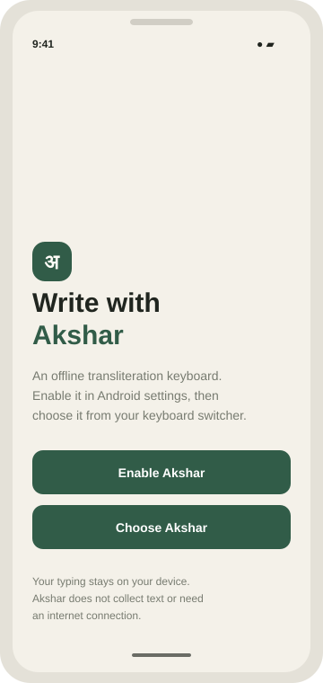
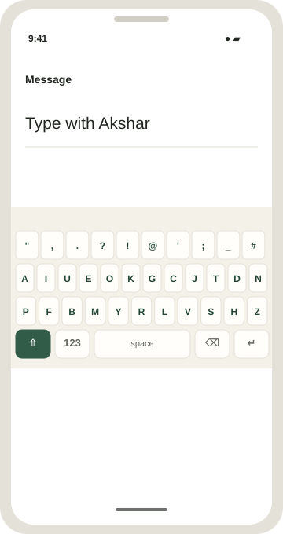
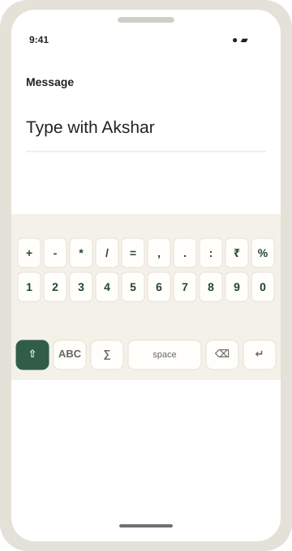
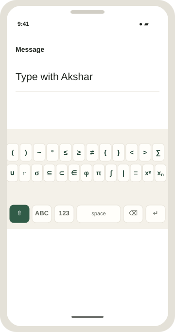

# Akshar Keyboard

Akshar is an offline Android transliteration keyboard with Latin-letter keys. The Android app is a real system input method: after enabling and selecting it, it can enter text in other apps. It has no Internet permission and does not collect or transmit typed text.

## App previews

These project illustrations show the setup screen and keyboard layout. They are mockups, not screenshots captured from a running Android device.

| Setup screen | Letter keyboard | Number and symbol keyboard | Maths keyboard |
| --- | --- | --- | --- |
|  |  |  |  |

Capture real device screenshots for the Play Store listing after building and testing the app.

## Keyboard pages

The keyboard has three pages: the letter page contains the letters, punctuation, `#`, and `_`; the number and symbol page has the number row, comma, period, colon, and additional symbols; the maths page has parentheses, braces, `<`, `>`, tilde, degree, comparison, set, union, intersection, summation, standard deviation, and congruence symbols, phi, pi, integral, a “such that” bar, superscript, and subscript keys. Use **123** on the letter page to open numbers, **ABC** on the number or maths page to return to letters, and **∑** on the number page to open the maths page. The maths page also has **123** to open the number and symbol page. All pages keep shift, backspace, space, and enter available.

## Build

Open this folder in Android Studio with JDK 17 and Android SDK Platform 36 installed. Allow Gradle sync, then build the `app` configuration. Or, with Gradle installed:

```text
gradle :app:assembleDebug
```

The debug APK is written to `app/build/outputs/apk/debug/`. For a Play Store release, use Android Studio's **Build > Generate Signed Bundle / APK** to create a signed Android App Bundle (`.aab`) and securely retain the upload key. Do not commit signing keys or passwords.

## Test the keyboard

1. Install the debug APK on a device or emulator.
2. Open Akshar Keyboard and tap **Enable Akshar**.
3. Enable Akshar in Android's input method settings, then return to the app.
4. Tap **Choose Akshar**, select Akshar, and type into a text field in another app.
5. Verify navigation between letters, numbers, and maths using **123**, **ABC**, and **∑**. Check number, letter/variant/punctuation insertion, the maths symbols, superscript and subscript mode toggles, shift toggling uppercase letters and variants, selection replacement, backspace, editor action/enter, and behavior in password fields. Android password fields may suppress custom keyboards according to system policy.

## Deploy to Google Play

1. **Confirm the app identity.** The current package/application ID is `com.akshar.keyboard`. Check that it is available before creating the Play Console app. The ID is the app's permanent Play Store identity; changing it later creates a different app.
2. **Prepare the Play Console account and app.** Create or use a Google Play Console developer account, complete any account verification, then create an app in Play Console. Follow the console's current requirements for account type, testing, target API level, and production access.
3. **Finish the store listing and policy forms.** Provide the app name, descriptions, category, contact details, app icon, feature graphic, and screenshots captured from the running app on a real device or emulator. The SVG previews above are mockups, not Play Store screenshots. Complete the content rating, target audience, and other required declarations accurately.
4. **Publish the privacy policy.** Replace the contact placeholder in `privacy-policy.html` with a monitored support email and host the policy at a stable, publicly accessible HTTPS URL. Add that URL in Play Console. Complete the Data safety form based on the actual release: this app has no Internet permission and is designed not to collect or transmit typed text. Recheck declarations if the app's behavior or dependencies change.
5. **Build and test a release.** In Android Studio, select **Build > Generate Signed Bundle / APK > Android App Bundle** and follow the signing prompts. Choose the `release` build variant. Create an upload key if needed, keep its keystore and passwords secure and backed up, and never add them to source control. Enroll in Play App Signing when prompted. Before release, install and test the release build on supported devices; check enabling/selecting the IME, typing in multiple apps, number keys, shift and uppercase output, maths symbols, superscript and subscript modes, punctuation, backspace, space, editor actions, accessibility, and behavior in password fields.
6. **Upload to a testing track.** In Play Console, create a release in an internal testing track and upload the signed `.aab` from `app/release/` (the exact output path is shown by Android Studio). Add testers, roll out the test, and fix any issues reported by device testing or Play's pre-launch checks.
7. **Request production rollout.** Complete any testing-track or production-access requirements shown for your developer account. Create a production release, upload the verified bundle, review Play Console's warnings and declarations, then submit it for review and roll it out when approved.
8. **Maintain the release.** Monitor review status, crashes, and feedback. For each update, increase `versionCode` in `app/build.gradle.kts`, rebuild and test a signed release bundle, and upload it as a new Play Console release.
